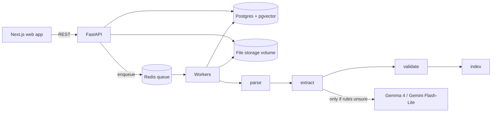

# Architecture

## What this system does
Users upload invoices (PDF, JPG, PNG, TIFF, XLSX, XLS, CSV). The system reads them (text layer, OCR, or spreadsheet parsing), extracts the key fields, checks the numbers, flags problems, stores everything, and lets people search, review and correct results. It can also cross-check documents against each other (PDF vs PDF, PDF vs Excel).

## Big picture

## One file's journey (the pipeline)
1. **Upload**: file checked (type by magic bytes, size, page limit), saved, a `documents` row is created, status UPLOADED, parse job queued.
2. **parse**: PDFs are examined page by page. Pages with a real text layer are read directly; scans and images go through OCR (Tesseract + OpenCV cleanup, 300 DPI). Each page gets a confidence score. A **segmenter** then splits a long PDF into individual invoices (new invoice number, "Page x of y", header change) and creates one `invoices` row per invoice with its page range. Spreadsheets/CSVs are parsed with pandas/openpyxl (header detection, all sheets) into `ledger_entries`; no LLM reads the rows.
3. **extract** (per invoice): cascade, cheapest first: (a) rules/regex, (b) Gemma 4 via Google AI Studio, (c) Gemini Flash-Lite for hard cases. Every field is `{value, confidence, evidence, page}`. A value whose evidence text is not found in the source is set to null and flagged. Nothing is invented. All LLM answers are cached by hash.
4. **validate**: missing fields, line items vs subtotal, subtotal + tax vs total, duplicates (exact and fuzzy), ambiguous currency, locale-safe numbers. Produces `validation_issues` with reason codes. Any error-level issue sets the invoice to NEEDS_REVIEW.
5. **index**: full-text vector (tsvector) and a small local embedding (fastembed, 384 dims) are stored on the invoice. Search = keyword + semantic merged (reciprocal-rank fusion) with SQL filters.
6. **review**: a human opens flagged invoices, edits fields (saved as `corrections`, validation re-runs), or reprocesses failed documents from the failed stage.

Cross-checks run on demand: match invoices to each other or to `ledger_entries` by invoice number + supplier, compare amounts, record result in `crosschecks`.

## Reliability rules (all lanes)
- Every stage is idempotent: re-running it for the same id overwrites its own output and never duplicates rows.
- Every stage writes `processing_events` (STARTED / SUCCEEDED / FAILED) with duration.
- Failure = document `status=FAILED` with a coded `error_code` from CONTRACTS.md. Never an unhandled crash, never a silent drop.
- Retries with backoff for transient errors (LLM 429, DB hiccup); permanent errors (corrupt file) fail immediately.
- Document text is untrusted input: it is wrapped as data in prompts and never treated as instructions.

## Security basics
- API key header on every endpoint except `/api/health`. Rate limiting on upload and search.
- Upload checks: magic bytes, max size, max pages, encrypted/corrupt detection. Stored filenames are generated, never user-supplied paths.
- No secrets in the repo.

## LLM budget (free tier)
Limits seen on the account: Gemma 4 26B/31B about 30 requests/min, 16K tokens/min, 14,400/day; Gemini Flash-Lite about 15/min, 250K tokens/min, 500/day. Because of the 16K tokens/min cap, rules-first extraction is essential, prompts must be short, and one shared rate limiter (by tokens and requests) must guard every LLM call.

## Folder ownership
| Folder | Lane |
|---|---|
| `backend/app/` core (api, db, models, queue, storage, config), `docker-compose.yml` | A |
| `backend/app/parsing/` | B |
| `backend/app/extraction/` | C |
| `backend/app/validation/` (incl. crosscheck) | D |
| `frontend/` | E |
| `tools/datagen/`, `data/`, `backend/tests/eval/` | F |
