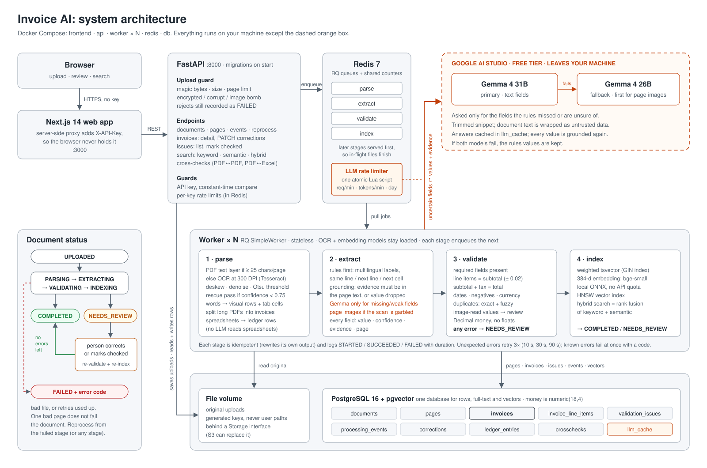
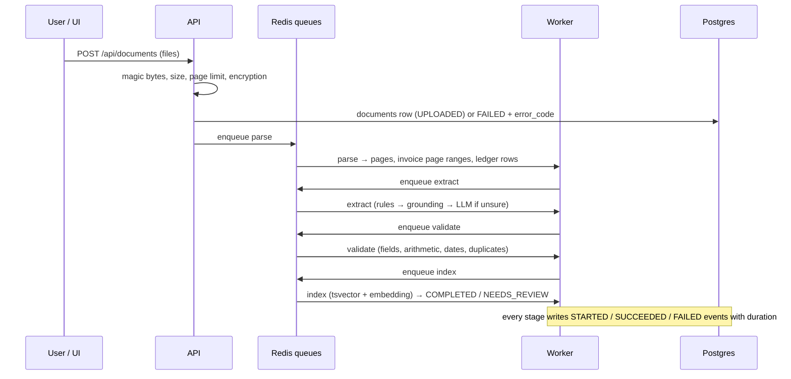
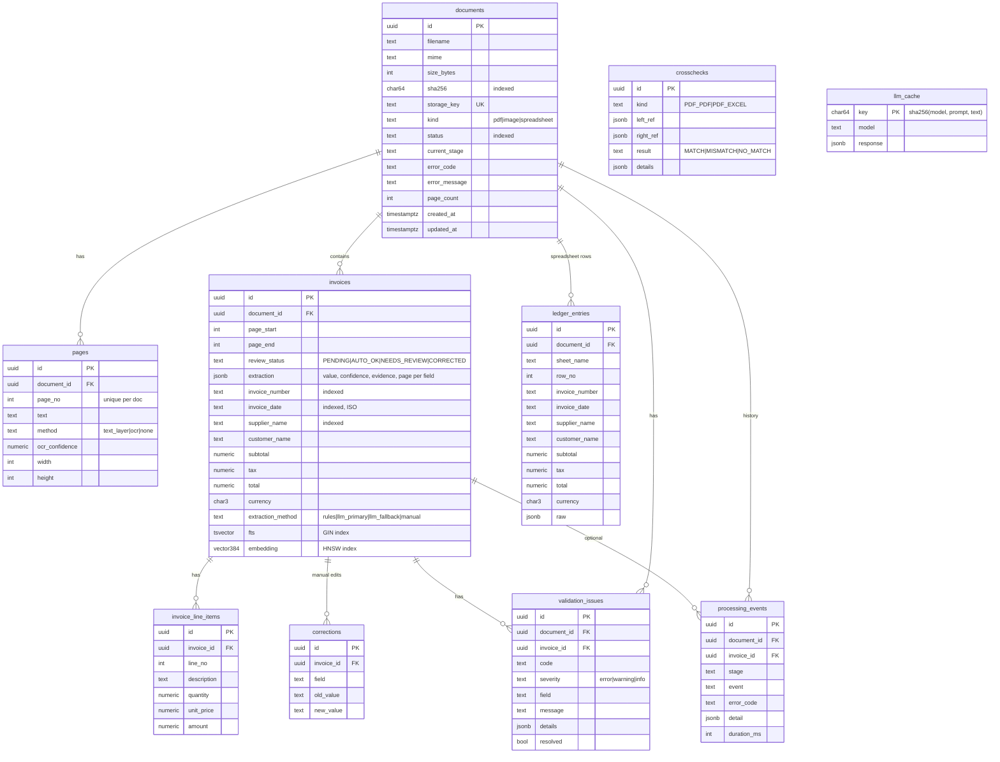

# Architecture

## What this system does
Users upload invoices (PDF, JPG, PNG, TIFF, XLSX, XLS, CSV). The system reads them (text layer, OCR, or spreadsheet parsing), extracts the key fields, checks the numbers, flags problems, stores everything, and lets people search, review and correct results. It can also cross-check documents against each other (PDF vs PDF, PDF vs Excel).

## Big picture

The orange path is the only traffic that leaves the machine. A high-resolution PNG for slides is in [`architecture.png`](architecture.png).

Containers (`docker-compose.yml`): `db` (pgvector/pg16), `redis`, `api` (runs Alembic migrations, then uvicorn), `worker` (2 replicas by default, each listening on all four stage queues), `frontend`.

## One file's journey (the pipeline)

1. **Upload**: the file type comes from its magic bytes. Size, page limit and encryption are checked, then the file is saved under a random key. A `documents` row is created with status UPLOADED and the parse job is queued. A rejected file is still recorded, with status FAILED and its error code, so failures are visible and counted.
2. **parse** (`app/parsing`): PDFs are read page by page. A page with at least 25 characters of text layer is used as is. Any other page is rendered at 300 DPI and OCR'd: OpenCV deskews it (up to ±10°), applies a median denoise and an Otsu threshold, and Tesseract reads it. If confidence is below 0.75, a slower "rescue" pass (contrast stretch plus non-local-means) runs and the better result is kept. Words are regrouped into visual rows, and wide gaps become tab-separated cells, so a label stays with its value. At most 8 page images are in memory at once, and OCR runs in a 4-thread pool. The **segmenter** then splits the PDF into invoices, using "Page k of N", a change of invoice number, or a change of header. Images (including multi-frame TIFF) follow the same OCR path. Spreadsheets (XLSX, XLS, CSV) have every sheet read; the header row is found by scoring rows against EN/FR/DE/ES synonyms, and rows go to `ledger_entries`. No LLM reads spreadsheet rows.
3. **extract** (`app/extraction`, per invoice): rules first. A line-aware extractor understands labels in several languages, values on the same line, next line or next cell, column-per-line tables, and locale-specific numbers and dates. Every value carries `{value, confidence, evidence, page}`. **Grounding** nulls any value whose evidence is not in the page text and adds `EVIDENCE_NOT_FOUND`. If a required field is still missing, or below 0.7 confidence, the primary LLM is asked for *only those fields*, with a trimmed snippet. If that fails, the fallback LLM is asked. LLM answers are grounded the same way. An answer without evidence is dropped and never replaces a rules value. Calls go through a Redis rate limiter shared by all workers (an atomic Lua script that enforces RPM, TPM and RPD) and are cached by hash in `llm_cache`.
4. **validate** (`app/validation`): missing fields, line items vs subtotal, subtotal + tax vs total (tolerance 0.02), qty × price vs amount, negative amounts, impossible or implausible dates, ambiguous currency, low confidence, low OCR confidence, and duplicates. A duplicate is *exact* (same supplier, number and total) or *fuzzy* (rapidfuzz supplier ≥ 90 and same number, or same total with dates within 3 days). An invoice is only flagged as a duplicate of an *older* one. If workers finish out of order, the older invoice's validation flags the newer copy. Any unresolved error means NEEDS_REVIEW.
5. **index**: a weighted `tsvector` (key fields weighted A, page text weighted D), plus a 384-dim embedding of a short invoice summary from a local ONNX model (no API quota). The document status becomes NEEDS_REVIEW if any invoice needs review, otherwise COMPLETED.
6. **review**: people correct fields in the UI with `PATCH /invoices/{id}`. Corrections are stored, the invoice is re-validated and re-indexed, and its status becomes CORRECTED. An issue that is not a problem (e.g. a known duplicate) can be marked checked. A failed document can be reprocessed from the failed stage or from any chosen stage.

**Search** (`GET /api/search`): keyword mode uses `websearch_to_tsquery` plus exact `ILIKE` matches on number, supplier and customer. Semantic mode uses pgvector L2 distance on unit vectors, which ranks the same as cosine, served by an HNSW index. Hybrid merges both lists with reciprocal-rank fusion (k = 60). All modes accept SQL filters for supplier, currency, date range, total range and review status.

**Cross-checks** (`POST /api/crosschecks/run`): exact key match (normalised invoice number + supplier) through a dict index, so cost is O(n). Total, subtotal, tax, date and currency are then compared. Results are stored in `crosschecks`, and mismatches become `CROSS_*` issues on the invoice.

## Reliability rules
- Every stage is idempotent: it deletes and rewrites its own output, so a re-run never duplicates rows (tested).
- Every stage writes `processing_events` (STARTED / SUCCEEDED / FAILED / RETRIED) with a duration.
- A `PipelineError` (corrupt file, OCR failed, ...) fails the document at once with its code. Any other error is retried by RQ three times with backoff (10 s, 30 s, 90 s), then fails with `INTERNAL_ERROR`. LLM 5xx errors and timeouts are retried inside the client. A 429 is handled by the shared limiter and then the fallback model.
- One bad page (OCR crash) marks that page `method=none` with a warning; the rest of the document continues.
- Workers use RQ's `SimpleWorker` (no fork per job), so the OCR engine and embedding model stay loaded. Later stages are served first, so documents already in flight finish before new ones start.

## Scaling
Workers are stateless. Add replicas (`WORKER_REPLICAS`), or dedicate workers to the `parse` queue for OCR-heavy loads. The LLM limiter lives in Redis, so the free-tier quota is respected however many workers run. Postgres handles relational data, full-text and vector search; past a few million invoices, the path is table partitioning by month and moving vectors to a dedicated index. Files sit behind a `Storage` interface (local volume now), so an S3 implementation can replace it.

## Security basics
- API key header on every endpoint except `/api/health` (constant-time comparison). Per-key fixed-window rate limits on upload and search, stored in Redis.
- The browser never holds the key; the Next.js server proxies requests.
- Uploads: magic bytes, max size, max pages, encrypted/corrupt detection, decompression-bomb guard for images. Stored file names are generated, never user-supplied paths (path traversal is rejected).
- Document text is untrusted: prompts wrap it in delimiters as data, and LLM values must be grounded in the document text.
- No secrets in the repo.

## LLM budget (free tier)
Measured limits on the account: Gemma 4 26B/31B, about 30 requests/min, 16K tokens/min, 14,400/day. Because the token cap is tight, extraction is rules first, prompts ask only for missing fields with a trimmed snippet (first page up to 3,000 characters, plus the totals area of the last page), and one shared limiter guards every call. Real calls showed the primary model taking 20–60 s and often returning HTTP 500/503, so the cascade falls back to the 26B model and keeps rules values when both fail.

## Database schema
Alembic migration `backend/alembic/versions/0001_initial_schema.py`; models in `backend/app/models.py`. All ids are UUIDs; money is `numeric(18,4)`.

## Folder ownership (lanes)
| Folder | Lane |
|---|---|
| `backend/app/` core (api, db, models, jobs, pipeline, storage, config), `docker-compose.yml` | A |
| `backend/app/parsing/` | B |
| `backend/app/extraction/` | C |
| `backend/app/validation/` (incl. crosscheck) | D |
| `frontend/` | E |
| `tools/datagen/`, `data/`, `backend/evaluation/` | F |
